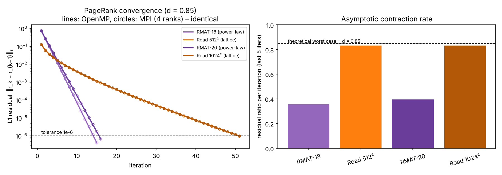
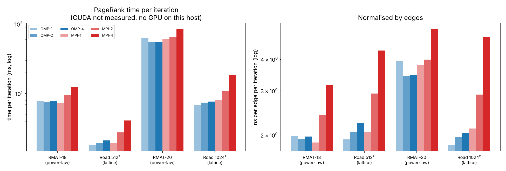
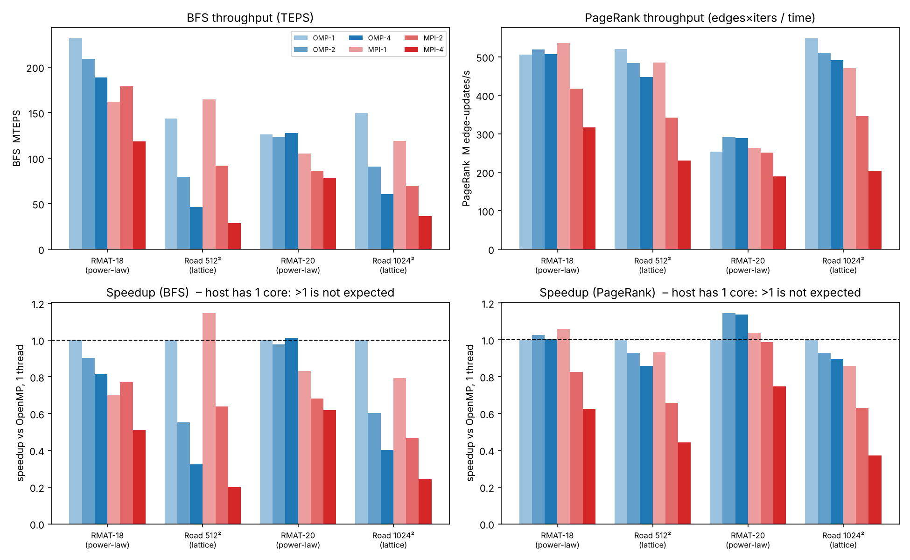
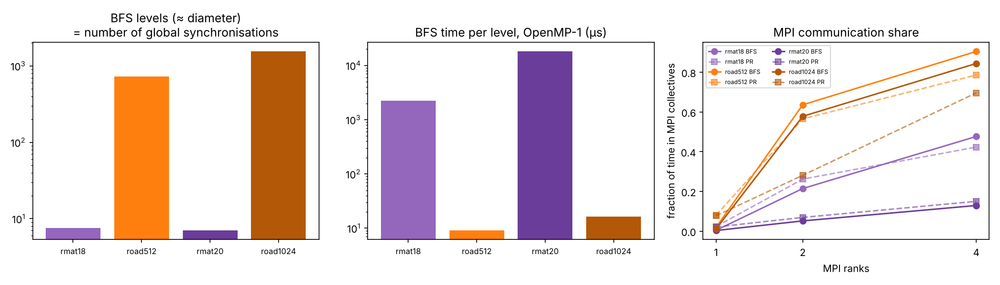

# Problem 12 — PageRank and Cross-Platform Synthesis
**Team 12:** Apeksh, Aadit, Akanksh

## 0. Read this first: what was and was not measured

| Item | Status |
|---|---|
| PageRank + BFS in **OpenMP** | Implemented, validated, **benchmarked** |
| PageRank + BFS in **MPI** (Open MPI 4.1.6) | Implemented, validated, **benchmarked** |
| PageRank + BFS in **CUDA** | Implemented and passes a clang CUDA syntax check (host + device, sm_70). **Never executed — no GPU/nvcc in our build environment. No CUDA numbers appear in any table or plot.** |
| Results of P9–P11 | **Not received.** We defined the common CSV schema and wrote `scripts/merge_csv.py` to ingest them; the merge has not been run on their data. |
| Real road networks (e.g. SNAP roadNet-CA) | **Not used** (no internet access for datasets). We use a synthetic road-like lattice, see §2. |
| Parallel speedup | **Not measurable on our host**: 1 vCPU (Xeon @ 2.1 GHz), 3 GB RAM. Threads/ranks > 1 are time-sliced on one core, so "speedup" below 1.0 is expected and says nothing about real scaling. |

What the measurements *can* support: algorithmic behaviour (iterations, BFS depth), single-worker throughput, per-iteration cost per edge, and how much synchronisation each graph class forces. All scaling and CUDA conclusions in §5–6 are labelled as expectation, not result. Re-running `scripts/run_all.sh` on a multicore/GPU machine fills in the missing columns with no code changes (`make cuda ARCH=sm_XX`).

## 1. Implementation

Common design: graphs are stored as CSR (out-edges) plus a transposed CSR (in-edges) built at load time; load/transposition is excluded from timings.

**PageRank** (d = 0.85, stop when the L1 change between iterations < 1e-6, cap 200):
`r'(v) = (1−d)/n + d·( Σ_{u→v} r(u)/outdeg(u) + D/n )`, where `D` is the total rank on dangling vertices (outdegree 0). Dangling mass is redistributed uniformly, so ranks always sum to 1. All platforms use the *pull* formulation (each vertex gathers from its in-neighbours), which needs no atomics.

| Platform | Parallelisation |
|---|---|
| OpenMP | `parallel for`, dynamic chunks of 1024 vertices for the gather (load balance on skewed degrees), reductions for dangling mass and residual |
| MPI | 1-D vertex partition balanced on (in-deg + out-deg + 1); each iteration: local gather → `Allgatherv` of new ranks → `Allreduce` of residual. Each rank holds the whole CSR (see limitations) |
| CUDA | contribution kernel + pull kernel; warp-per-vertex if mean degree ≥ 8 (power-law), thread-per-vertex otherwise (road); block-level residual reduction; host tests the residual each iteration |

**BFS** (top-down, level-synchronous, directed out-edges, 8 roots per graph chosen identically on every platform from vertices whose BFS reaches ≥ 10 % of the graph):
OpenMP — per-thread next-frontier buffers, `atomicCAS`-style claim of `dist[v]`; MPI — owners expand their local frontier, candidates exchanged by `Allgatherv`, every rank updates a replicated `dist`; CUDA — explicit frontier queue, warp per frontier vertex, `atomicCAS`.
TEPS = (sum of out-degrees of reached vertices) / BFS time. For PageRank we report the analogous edge-updates/s = m·iterations / time.

**Correctness.** `scripts/validate.py` compares each platform's final rank vector with an independent SciPy power iteration run to 1e-12. OpenMP and MPI (1, 3 and 4 ranks) agree to L1 error 2.0e-7 (RMAT-14) and 4.3e-7 (road-128) — the size expected from the 1e-6 stopping rule — and ranks sum to 1 to 1e-12. BFS level counts and traversed-edge counts are identical between OpenMP and MPI. Iteration counts are identical across all OpenMP/MPI configurations.

## 2. Experimental setup

Graphs (`results/graph_stats.csv`):

| graph | type | n | m | avg deg | max out / in deg | dangling % | PR iters | BFS levels |
|---|---|---|---|---|---|---|---|---|
| rmat18 | power-law | 262,144 | 3,938,572 | 15.0 | 15,811 / 16,022 | 43.2 | 15 | 7 |
| rmat20 | power-law | 1,048,576 | 16,084,975 | 15.3 | 39,741 / 39,466 | 47.8 | 16 | 7 |
| road512 | road-like | 262,144 | 941,794 | 3.6 | 4 / 4 | 0 | 51 | 725 |
| road1024 | road-like | 1,048,576 | 3,771,302 | 3.6 | 4 / 4 | 0 | 51 | 1,544 |

- **Power-law:** Graph500 RMAT (a=.57, b=.19, c=.19, d=.05), edge factor 16, directed, duplicates/self-loops removed, vertex labels randomly permuted.
- **Road-like:** 2-D lattice with 10 % of edges removed, bidirectional (degree ≤ 4, diameter ∝ √n). It reproduces the two properties that matter here — low uniform degree and high diameter — but is *not* a real road map and has perfectly regular, spatially ordered vertex IDs, which a real dataset would only partly have.
- Matched vertex counts (2¹⁸ and 2²⁰) so graph class, not size, drives the comparison.
- Workers: OpenMP 1/2/4 threads, MPI 1/2/4 ranks. PageRank: 3 timed repetitions (median reported). BFS: 8 roots (total time over roots reported).
- Common CSV (`results/all_results.csv`, 264 rows): `platform,algorithm,graph,graph_type,n,m,workers,run,iterations,time_s,time_per_iter_ms,edges_processed,teps,notes`. For BFS, "iterations" = levels. MPI rows carry `comm_frac` in `notes`.

## 3. Results

**Convergence** — `figures/fig1_convergence.png`. OpenMP and MPI curves coincide point-for-point.



**Time per iteration** — `figures/fig2_time_per_iteration.png`.



**TEPS and speedup** — `figures/fig3_teps_speedup.png` (speedup relative to OpenMP-1; remember the 1-vCPU caveat).



**Why the graph classes behave differently** — `figures/fig4_structure_effects.png`.



Key single-worker numbers (OpenMP-1; full tables in `results/summary_tables.md`):

| graph | PR ms/iter | PR ns/edge/iter | BFS MTEPS (min–max over roots) | BFS µs/level |
|---|---|---|---|---|
| rmat18 | 7.79 | 1.98 | 232 (219–240) | 2,244 |
| rmat20 | 63.4 | 3.94 | 126 (103–147) | 18,065 |
| road512 | 1.81 | 1.92 | 143 (126–165) | 9.1 |
| road1024 | 6.88 | 1.82 | 150 (118–186) | 16.3 |

**Noise.** OpenMP-1 and MPI-1 execute essentially the same work, yet differ by up to ~30 % on BFS (and ≤ 6 % on PageRank) on this shared VM. Differences smaller than roughly that band should not be interpreted.

## 4. Platform recommendation table

"Measured" cells come from our runs; "Expected" cells are architectural reasoning that we could not test.

| Workload | Recommended | Evidence | Caveat |
|---|---|---|---|
| PageRank, power-law, graph fits one node, CPU only | **OpenMP** | 250–540 M edge-updates/s on one core; no communication; dynamic scheduling handles degree skew up to ~40k | Multi-thread scaling not measurable here |
| PageRank, power-law, GPU available | **CUDA (warp-per-vertex)** | *Expected:* PageRank is memory-bandwidth-bound with ~16 iterations and many independent vertices, the best case for a GPU | **Not measured.** Random gather limits achieved bandwidth well below peak |
| PageRank, road-like | **OpenMP** (or CUDA thread-per-vertex) | Cost is flat at ~1.8–1.9 ns/edge/iter, but needs ~3.2× more iterations (51 vs 15–16) | CUDA not measured; spatially ordered IDs help caches here |
| BFS, power-law | **OpenMP** (CUDA expected competitive) | Only 7 levels → huge frontiers, few barriers; 125–230 MTEPS single core | MPI viable: comm share 5–48 % at 2–4 ranks, but inflated by oversubscription |
| BFS, road-like | **OpenMP with few threads, or single thread; avoid MPI** | 725–1,544 levels of ~9–16 µs each; MPI comm share 58–90 % at 2–4 ranks; OpenMP-4 speedup 0.3–0.4 on our host | *Expected:* GPU is latency-bound (a kernel launch + host sync per level), so only worthwhile when batching many BFS or fusing levels. **Not measured** |
| Graph larger than one node's memory | **MPI** (only option that can span nodes) | Communication per PageRank iteration is a single `Allgatherv`; power-law comm share was 7–42 % at 2–4 ranks | Our MPI code replicates the CSR on every rank, so it does *not* yet reduce per-node memory; a distributed CSR is required |
| Multiple BFS roots / many queries | **CUDA or OpenMP over roots** | *Expected:* amortises per-level latency | Not measured |

## 5. Discussion

**Convergence is a property of the graph, not the platform.** Every OpenMP and MPI configuration took exactly 15/16 iterations on RMAT and 51 on both road graphs, and the residual curves coincide. Parallelisation therefore changed time per iteration but never the iteration count, so the platform comparison can be made on per-iteration cost and the graph comparison on iteration count. The measured asymptotic contraction factor is 0.36–0.40 per iteration on RMAT but 0.833 on the lattices — essentially the theoretical worst case of the damping factor (0.85). Our interpretation, consistent with but not proven by these runs: the lattice has a spectral gap close to zero for the underlying walk, so only damping contracts the error, whereas RMAT mixes quickly (and ~45 % of its vertices are dangling, whose uniformly redistributed mass further speeds mixing). The road graphs thus need 3× as many iterations to reach the same tolerance, independent of size (51 at both 262k and 1M vertices).

**Per-iteration cost: locality, not degree, dominated.** PageRank's cost per edge was ~1.8–2.0 ns on three of four graphs but 3.9 ns on RMAT-20, i.e. it doubled when the random-gather working set grew 4×. Road graphs stayed flat. This mixes two effects we did not separate: RMAT's random access pattern (its labels were permuted) and the road lattice's row-major, spatially coherent labels. Because of that confound we cannot say how much of the gap is intrinsic to power-law structure versus our labelling; a relabelled lattice or a degree-ordered RMAT would isolate it.

**Power-law versus road networks: parallelism shape is opposite.** RMAT has high degree and tiny diameter: BFS finishes in 7 levels, each level moving millions of edges (2–18 ms), so barrier and launch costs are negligible and the work is coarse-grained. Road graphs invert this: 725–1,544 levels of only 9–16 µs each, so the algorithm is dominated by synchronisation. This shows directly in our data: from 1 to 4 workers, BFS on RMAT-20 held throughput (speedup 1.01 for OpenMP) while road BFS fell to 0.32–0.40, and MPI's communication share on road BFS reached 58–90 % versus 5–13 % on RMAT-20. PageRank, which synchronises once per iteration regardless of graph shape, is far less sensitive: it dropped only ~10–15 % on roads under 4 OpenMP threads. This is also why PageRank and BFS together are a better test than either alone — PageRank stresses bandwidth, BFS stresses synchronisation.

**Platform conclusions.** (i) OpenMP was the best or tied-best measured option for every workload: it has no data exchange and its per-level overhead is the smallest. (ii) MPI added cost on one node; its communication share grows with rank count and was worst exactly where levels are numerous and tiny (road BFS). Caveat: with ranks time-sliced on one core, "communication time" includes waiting for descheduled peers, so these shares overstate real network cost; the *ordering* (road > RMAT) is the robust finding. MPI's case rests on memory capacity and multi-node scale, which our single-node, replicated-CSR implementation could not demonstrate. (iii) For CUDA we only have design reasoning: the PageRank pull kernel maps well to a GPU, whereas road-network BFS is expected to be launch/sync-latency-bound because it needs >700 dependent kernel launches with a host round-trip each. This prediction is the most valuable thing to test next.

**Limitations.** One vCPU, so no real scaling or speedup data; no CUDA execution; synthetic road graph; top-down-only BFS (a direction-optimising BFS would help RMAT, not roads); MPI replicates the whole graph per rank and gathers the full rank vector (O(n) per rank per iteration); `comm_frac` is confounded by oversubscription; single-run noise of up to ~30 % on BFS; P9–P11 data not integrated.

**Next steps.** Run `scripts/run_all.sh` (THREADS/RANKS lists configurable) on a multicore node and a GPU node; substitute SNAP road/web graphs for `data/*.bin` (the binary CSR format is documented in `src/gen.cpp`); merge P9–P11 CSVs via `scripts/merge_csv.py`; add frontier-fused CUDA BFS.

## 6. Reproduce
```
make                       # gen, graph_omp, graph_mpi   (make cuda ARCH=sm_80 on a GPU box)
sh scripts/make_graphs.sh
bash scripts/run_all.sh    # -> results/all_results.csv, results/convergence.csv   (uses ./graph_cuda if built)
python3 scripts/validate.py rmat14 road128   # needs dumps from -d flag
python3 scripts/analyze.py # figures + results/summary_tables.md
```
References: Page, Brin, Motwani, Winograd, *The PageRank Citation Ranking* (1999); Graph500 specification (RMAT parameters).
